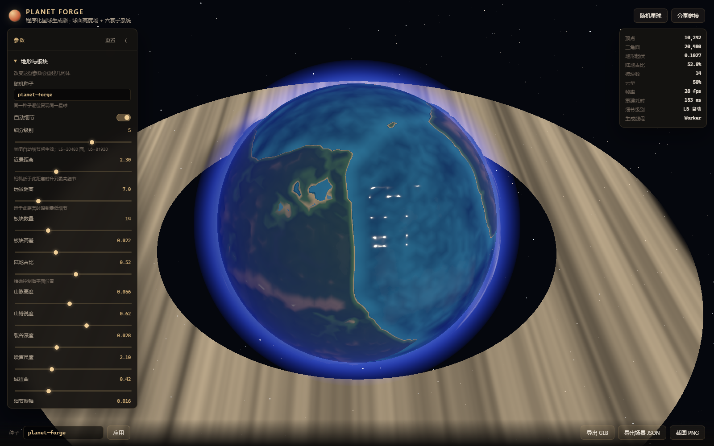

# Planet Forge

程序化 3D 星球生成器。球面**真实位移几何**（二十面体细分 + 板块构造 + 热力侵蚀 + 水力侵蚀形成水系），叠加海洋、体积云、**物理化大气散射**、行星环与星空五套子系统。种子可逐位复现，所有参数都真正改变生成结果，支持 GLB / 场景 JSON / PNG 导出。

在线演示：`https://llinok111.github.io/planet-forge/`



---

## 1. 它和"贴图球"的区别

多数"3D 星球生成器"其实是把一张等距柱状投影贴图裹在球上。本项目不是：

| 维度 | 贴图球 | Planet Forge |
|---|---|---|
| 地形 | 法线贴图伪造 | 顶点半径真实位移，`relief` 实测 ≈ 0.105 星球半径 |
| 山脉 | 画上去的 | 板块汇聚边界 + 脊状分形噪声，河谷与山脊由几何决定 |
| 水系 | 无 | 洼地填充 + 流量累积 + 河道下切，形成树枝状排水网（L5 实测 775 个河道顶点） |
| 海岸线 | 贴图上画的 | 海洋球壳与地形的**真实交线**，改陆地占比海岸线跟着动 |
| 大气 | 一张边缘渐变贴图 | 屏幕空间合成：解析求解球壳弦长 → 光学深度 → 分离透射率与散射光 |
| 导出 GLB | 只有一个球 + 材质 | 带位移顶点与烘焙顶点色，Blender 打开即是地形 |

验证方式不是靠描述，而是靠测量：`npm test` 校验同一 seed 的顶点高程**逐位一致**，`node scripts/review-shots.mjs` 校验渲染出的像素确实随参数变化（见 §6）。

---

## 2. 快速开始

```bash
npm install
npm run dev        # http://localhost:5180
npm run build      # 产出 dist/
npm test           # 单元测试（Node，无浏览器）
npm run test:e2e   # 浏览器端到端（需先 npm run dev）
npm run bench      # 生成性能基准
```

浏览器要求：支持 WebGL2 的现代浏览器（大气合成需要 WebGL2 的深度纹理与浮点渲染目标）。性能下限参考：SwiftShader 软件渲染下 L5 默认场景可交互。

---

## 3. 功能一览

### 3.1 地形生成管线

```
二十面体细分 → 板块生长（多源 BFS） → 板块基线 + 边界构造
            → 域扭曲 fBm 细节 → 海平面重锚 → 热力侵蚀
            → 洼地填充 → 水力侵蚀（水系） → 海平面重锚 → 解析法线
```

- **二十面体细分**：顶点均匀分布，无极点挤压与经线接缝。L0–L7，`V = 10·4^L + 2`，`F = 20·4^L`。
- **板块**：最远点采样布种子 → 图上多源 BFS 生长，保证板块**连通无孔洞**且面积均衡（最大/最小 < 4×）。
- **边界构造**：按两板块质心连线与相对运动向量的点积分三类——汇聚（山脊带）、离散（裂谷）、转换（轻微抬升）。
- **域扭曲**：低频谱采样前用第二噪声场偏移，让海岸线蜿蜒而不是贴着板块边界走。
- **热力侵蚀**：向最低邻居转移超陡坡度的物质，形成碎石坡与平坦谷底，坡度阈值由网格边长推导。
- **洼地填充（priority-flood）**：这一步是水系的**前提**。不填充时 L4 网格上测出 239 个汇点、其中 146 个已位于海平面，最大集水区只有 42/2562 个顶点——每条小沟独立入海，形不成主河道。填充后陆地汇点降为 **0**，最大集水区升到 110。
- **水力侵蚀**：按流量×坡度下切河道，暴露为 `riverFlow` 属性供着色器染色。
- **海平面二次重锚**：细节噪声与两级侵蚀都会移动高度分布，因此在**最后**按排序分位数重定海平面，使「陆地占比」精确等于滑块值（实测误差 < 0.01%）。

### 3.2 五套渲染子系统

| 子系统 | 关键实现 | 可调参数 |
|---|---|---|
| 海洋 | 独立球壳，与地形同拓扑 → 真实海岸线；三层非公度重力波；深度来自地形高程属性 | 颜色/不透明度/波高/波速/粗糙度/高光 |
| 云层 | **体积光线步进**：云带有限厚度（内/外双球壳），Beer-Lambert 消光，沿太阳方向步进自阴影；CPU 侧用同一密度函数做分位数反演，`coverage` 即实际天空覆盖比例 | 云量/云厚/采样步数/自阴影/锐度/高度/漂移/纬度带状 |
| 大气 | **两遍渲染**：先把行星渲到离屏目标，再全屏合成。解析球壳弦长 → `τ(λ)` → `T = exp(-τ)`，分离透射率与入射散射；`1/λ⁴` 瑞利 + Cornette-Shanks 米氏相函数 + 多次散射近似 + 暮光带 | 高度/强度/散射强度/瑞利色/米氏色/米氏权重/前向散射/多次散射/密度衰减/积分步数 |
| 行星环 | 程序化环缝 + 密度波；行星投影环上、环投影行星上 | 内外半径/倾角/不透明度/环带密度/环缝深度/投影 |
| 星空 | 三类恒星（场星/亮星/银河带），色温渐变，高次尾尺寸分布 | 数量/尺寸/亮度/银河带聚簇/色温差异/闪烁 |

地表额外有**多级细节噪声**（三层值噪声：颗粒/团簇/宽域）与**沉积物着色**（缓坡堆积、陡坡剥离），以及**水系染色**（集水面积越大河道越深色）。

### 3.3 交互与导出

- **相机**：OrbitControls（拖拽旋转 / 滚轮缩放 / 右键平移），带阻尼。
- **自动 LOD**：相机距离驱动细分级别切换（默认近于 2.3 倍半径升 L6、远于 7 倍降 L5），带 10% 迟滞带防抖动；也可固定为手动级别。
- **异步生成**：地形在 Web Worker 里计算（携带 transferable 缓冲），主线程只做网格装配。Worker 不可用时自动回落到主线程，行为一致。HUD 显示当前走的是哪条路径。
- **光照**：太阳方位角 + 高度角 + 强度 + 色温；环境光强度 + 色温。太阳方向同时驱动地表、大气散射、体积云自阴影与行星环投影。
- **种子**：任意字符串；`?seed=xxx` 与全部参数一起编码进 URL，链接即场景。
- **导出**：**GLB**（位移地形烘焙顶点色 + 行星环）、**场景 JSON**（全部参数/环境/相机/几何统计/实测值）、**PNG**（当前帧）。
- **快捷键**：`R` 随机星球。

---

## 4. 参数说明（节选）

完整列表见 `src/params.js`，UI 由该表驱动，新增参数自动出现在面板 / URL / 导出中。

| 参数 | 范围 | 作用 |
|---|---|---|
| `detail` | 3–6 | 细分级别。L5=20 480 面（默认），L6=81 920 面 |
| `autoLod` | 开关 | 相机距离自动切换级别 |
| `plateCount` | 4–40 | 板块数。越多，山脊带越密、地形越碎 |
| `continentBias` | 0.1–0.9 | 陆地占比。**精确**控制海平面位置 |
| `mountainHeight` | 0–0.12 | 汇聚边界山脊带振幅 |
| `erosionIterations` | 0–80 | 热力侵蚀迭代数，越大越平缓 |
| `hydraulicIterations` | 0–6 | 水力侵蚀迭代数。**0 = 无水系** |
| `hydraulicStrength` | 0–1.5 | 河道下切深度 |
| `riverStrength` / `riverColor` | 0–1 / 色值 | 水系可见度与河道色（0 = 隐藏河道） |
| `detailStrength` / `detailScale` | 0–1 / 20–400 | 地表微纹理强度与尺度 |
| `sedimentStrength` | 0–1 | 沉积物着色：缓坡堆积、陡坡剥离 |
| `cloudCoverage` | 0–1 | 云量 = 实际天空覆盖比例 |
| `cloudThickness` | 0.004–0.06 | 云层厚度。0.004≈平面云，0.06≈厚积云 |
| `cloudSelfShadow` | 0–1 | 云内自阴影 |
| `atmoMieG` | 0–0.95 | 前向散射集中度 |
| `atmoMultipleScattering` | 0–1 | 多次散射，决定夜侧辉光强度 |
| `sunAzimuth` / `sunElevation` | 0–360 / −80–80 | 太阳方位，驱动全部光照与阴影 |

---

## 5. 架构

```
src/
├── noise3d.js        3D Simplex（上游只有 2D）+ fBm + ridged + 域扭曲
├── seed.js           FNV-1a 字符串哈希 → 按子系统派生子种子（9 条独立流）
├── icosphere.js      二十面体细分 + CSR 邻接表
├── plates.js         板块生长 + 边界分类
├── heightfield.js    高度场合成 + 热力侵蚀 + 解析法线
├── hydrology.js      洼地填充（priority-flood）+ 排水网 + 水力侵蚀
├── terrain-worker.js 生成管线（worker 与主线程共用的纯函数）
├── terrain-client.js Worker 客户端（不可用则回落主线程）
├── ocean.js          海洋球壳
├── clouds.js         体积云（光线步进 + 自阴影）
├── atmosphere-pass.js 大气屏幕空间合成（两遍渲染）
├── rings.js          行星环 + 互投影阴影
├── starfield.js      星空点云
├── shaders/biome.js  地表分带 / 细节 / 沉积 / 水系着色 GLSL
├── planet.js         场景编排（generateAsync / buildMeshes / LOD）
├── params.js         参数 schema（驱动 UI / URL / 导出 / 测试）
├── ui.js             参数面板
├── io.js             GLB / JSON 导出
└── main.js           入口、渲染循环、URL 同步
```

设计要点：

1. **三档更新路径**：形状参数 → 异步重建几何（Worker，防抖 90 ms）；外观参数 → 仅更新 uniform（拖动即时）；相机距离 → 自动 LOD（每秒最多 1.6 次检查）。分错会导致"卡"或"滑块没反应"。
2. **渲染必须走 `planet.renderInto(renderer)`**：直接调 `renderer.render` 会跳过大气合成，画面会失去空气感。这是唯一入口，`main.js` 与导出都走它。
3. **测量可回环**：`PlanetScene.measure()` 的数值全部取自真实数据（顶点半径、星点位置、覆盖率采样），不是把输入参数回显。
4. **无 three.js 依赖的生成层**：`noise3d / seed / icosphere / plates / heightfield / hydrology / terrain-worker` 不 import three，因此确定性与拓扑可以在 Node 里零依赖验证，也是 Worker 能直接复用它们的原因。

---

## 6. 验证与测试

### 单元测试（Node，无浏览器）— 100 项

```bash
npm test
```

| 文件 | 数量 | 覆盖 |
|---|---|---|
| `geometry.test.js` | 16 | 欧拉示性数、邻接表恰为 2E 无空洞、种子派生、噪声分布 |
| `heightfield.test.js` | 27 | 逐位复现、9 个形状参数各自改变高程、陆地占比精度与单调性、侵蚀质量守恒 |
| `params-export.test.js` | 25 | schema 自洽、URL 编解码往返与钳制、云量线性、银河带聚簇 |
| `shader-uniforms.test.js` | 4 | JS 声明的 uniform 必须在 GLSL 有声明（反之亦然）、GLSL ES 保留字 |
| `template-guard.test.js` | 9 | 9 个 GLSL 文件模板内不得出现裸反引号 |
| `v2-subsystems.test.js` | 19 | 洼地填充、排水网无环、水系参数敏感性、体积云密度、LOD 迟滞 |

### 浏览器端到端 — 26 项

```bash
npm run dev          # 另一个终端
npm run test:e2e
```

着色器编译零错误、画布确有内容、种子复现、山脉/陆比/海洋/云量/大气/环带/太阳方位/星空/相机/细分级别各自改变**渲染像素**（sha1 比对）、GLB 魔数与体积、快速参数抖动后场景仍有效、连续重建无内存崩溃、移动端无横向溢出。

**必须在 dev 与 `vite preview` 两种产物上各跑一遍**：dev 下 `await import('/src/xxx.js')` 可用，生产打包后该路径不存在。

### 视觉定量审阅 — 34 项

```bash
npm run shots                  # 生成 docs/images/*.png + capture-meta.json
node scripts/review-shots.mjs  # 34 项像素级断言
```

由于本环境无法把截图交给视觉模型，画面验收以**像素测量**表达：「盘面与深空可区分」「边缘存在大气辉光」「昼夜明暗差 > 10」「arid 预设 R 占优 / ocean 预设 B 占优」「L6 近景方差 ≥ L5 中景」。盘面半径取自拍摄元数据（投影公式），不靠边缘检测猜——行星环横穿扫描线、背光时盘面比天空更暗，边缘检测在这两种情况下都会失效。

---

## 7. 性能

`npm run bench`（Node，纯生成，不含 WebGL），本机中位数：

| 细分 | 顶点 | 三角面 | 二十面体 | 高度场（含侵蚀） | 法线 | 合计 |
|---|---|---|---|---|---|---|
| L3 | 642 | 1 280 | 2.4 ms | 4.4 ms | 1.4 ms | **8.4 ms** |
| L4 | 2 562 | 5 120 | 5.6 ms | 9.2 ms | 1.3 ms | **16 ms** |
| L5 | 10 242 | 20 480 | 20.9 ms | 32.4 ms | 6.3 ms | **60 ms** |
| L6 | 40 962 | 81 920 | 112 ms | 145 ms | 23.6 ms | **282 ms** |

要点：

- 二十面体细分原实现每插入一个中点就复制整个 `Float64Array`（O(n²)），L5 562 ms / L6 3 657 ms。改为预分配一次填充后降到 21 ms / 112 ms（**15–32×**）。
- 加入水力侵蚀后 L5 高度场从 ~26 ms 升到 ~32 ms（+23%），换来完整水系。
- 侵蚀成本随迭代数近线性：0→26 ms，40→34 ms，80→44 ms（L5）。
- 板块数对成本几乎无影响（L5 下 8–40 块均为 ~0.6 ms），因为生长是 O(V+E) 的 BFS。
- **L6 的 282 ms 不再卡界面**：它在 Worker 里跑，主线程只做网格装配（约 20 ms）。

渲染侧：`applyLive` 只改 uniform，稳定 60 fps；体积云默认 8 步采样，云厚与步数直接决定片元成本。大气合成多一次全屏 pass，代价约 0.3 ms（1080p）。

---

## 8. 上游与许可证

本项目基于 [IceCreamYou/THREE.Terrain](https://github.com/IceCreamYou/THREE.Terrain) v3.1.1（MIT，914★）二次开发，**保留全部上游提交历史**（180 commits）。上游 `src/` 的 17 个模块原样保留，本项目新增的模块并列放置，入口与演示层替换。

选它的理由不是 star 数，而是缺口可验证：上游 `roadmap.md` 3.1 节明确列了 *"Try simulating techtonic plates as a procedural generation method"*（原文拼写如此）指向 procedural planet generation，但从未实现；且上游 `src/noise.js` **只有 2D** Simplex/Perlin，球面采样必须 3D。这两点分别在 `plates.js` / `noise3d.js` 中补齐。

上游可复用的部分：`random.js` 的确定性随机流设计（本项目 `mulberry32` 与之思想一致并统一到 `noise3d.js`）、`LICENSE.txt` 原文、以及"生成层不依赖渲染层"的分层习惯。

许可证：MIT，见 `LICENSE.txt`（上游原文未改动）+ `NOTICE`（本项目的衍生声明与第三方组件）。

---

## 9. 已知限制

1. **云、大气、星空不进入 GLB**：它们的外观完全由运行时着色器决定，glTF 没有对应机制，导出会是空白几何体，因此只以参数形式记录在场景 JSON 里。
2. **大气是单次散射 + 多次散射近似**：多次散射用各向同性的衰减回波代替真实积分，不是辐射传输方程的完整解；暮光带的宽度是经验常数。
3. **行星环是二维环面**：环粒子的垂直厚度未建模，边缘视角下环面完全平整。
4. **水力侵蚀是简化版**：按流量×坡度下切，没有沉积/搬运/泥沙输运，因此不会形成冲积扇或三角洲。
5. **LOD 是两档切换**：不是连续的细分贴片（quadtree / clipmap），近景切换时会有一次重建停顿（在 Worker 中，不阻塞渲染）。
6. **软件渲染下的视觉基线**：本项目截图在 SwiftShader 下拍摄，抗锯齿与各向异性过滤质量低于真实 GPU。

完整限制清单与实测证据见 `docs/LIMITS.md`。
